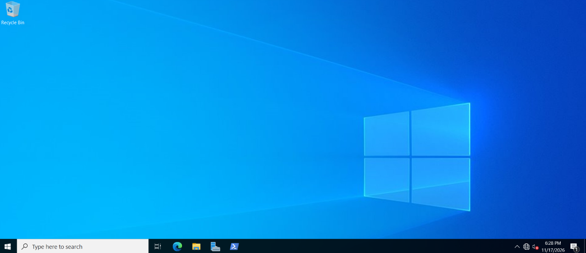
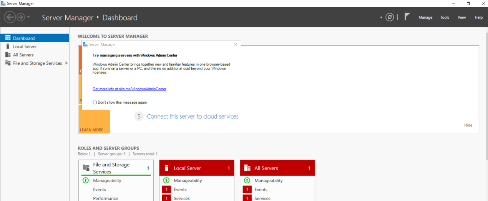

Day 01 – VMware Setup & Windows Server Installation

1. Objective

The objective of this lab was to prepare a virtualized environment and install Windows Server 2022 as the foundation for a practical Active Directory and IT infrastructure lab.

2. Host Machine Specifications

The lab was created using the following host machine:

| Component | Specification |
|---|---|
| Laptop | HP ProBook 440 G8 |
| Processor | Intel Core i7-1165G7 |
| CPU Cores | 4 Cores / 8 Logical Processors |
| Installed RAM | 16 GB |
| Host Operating System | Windows 10 Pro |
| Virtualization Support | Enabled |

3. Virtualization Platform

**Software:** VMware Workstation Pro

VMware Workstation was used to create and manage isolated virtual machines without requiring additional physical hardware.

4. Virtual Machine Configuration

A new virtual machine was created with the following configuration:

| Setting | Value |
|---|---|
| VM Name | WS2022-DC01 |
| Guest Operating System | Windows Server 2022 |
| Compatibility | Workstation 25H2 or later |
| Memory | 4 GB |
| Processor | 2 CPU Cores |
| Virtual Disk | 40 GB |
| Disk Provisioning | Single file, dynamically allocated |
| Network Adapter | Custom – VMnet1 (Host-only) |
| Installation Type | Custom Installation |

5. Network Configuration

The virtual machine was connected to:

**VMnet1 – Host-only Network**

This network provides an isolated environment for communication between virtual machines and the host machine.

The lab uses an isolated network to practice server administration and domain services without exposing the lab environment directly to the external network.

6. Windows Server Installation

The installation was performed using the official Windows Server 2022 Evaluation ISO.

Selected operating system edition:

Windows Server 2022 Standard Evaluation (Desktop Experience)**

Installation steps:

1. Mounted the Windows Server 2022 ISO file.
2. Booted the virtual machine.
3. Selected the Windows Server 2022 Standard Evaluation edition with Desktop Experience.
4. Accepted the license terms.
5. Selected Custom installation.
6. Selected the 40 GB unallocated virtual disk.
7. Completed the installation.
8. Set the Administrator password and logged in successfully.

7. Initial Verification

After installation, the server desktop and Server Manager were successfully loaded.

The following PowerShell command was used to verify the operating system:

```powershell
Get-ComputerInfo | Select-Object WindowsProductName, WindowsVersion, CsName
```

The installed operating system was verified as:

`Windows Server 2022 Standard Evaluation`

8. VMware Tools

VMware Tools was installed to improve communication and integration between the host machine and the virtual machine.

The installation enabled features such as copy and paste between the host and guest operating systems.

9. Outcome

Successfully created and installed a Windows Server 2022 virtual machine.

The server is ready for initial configuration, including hostname configuration, static IP addressing, and DNS setup.

10. Next Steps

- Configure a descriptive server hostname.
- Inspect and configure network settings.
- Assign a static IPv4 address.
- Prepare the server for Active Directory Domain Services (AD DS).
11. Lab Screenshots
Windows Server Desktop


Server Manager



