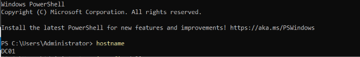
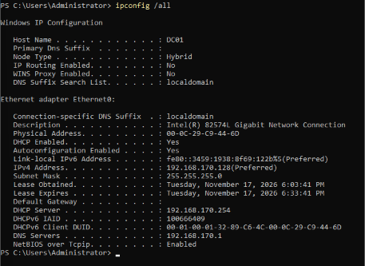
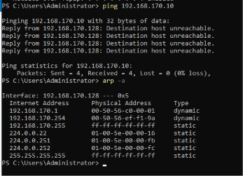
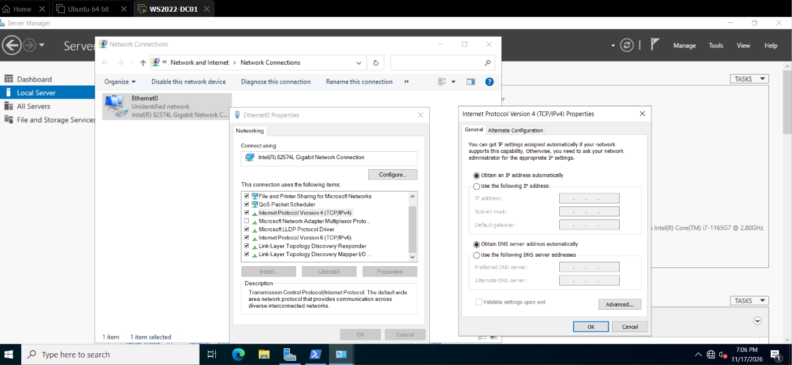
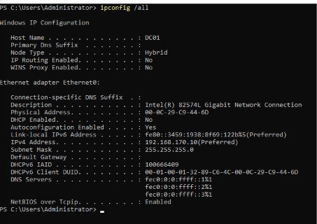
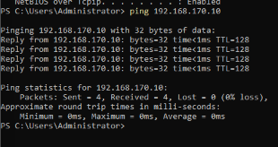
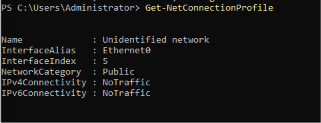
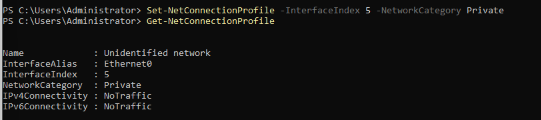
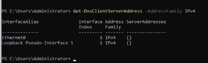

# Day 02 – Initial Server Configuration

## Overview
Configured the initial network settings of the Windows Server 2022 virtual machine and verified network connectivity.

## Server Information

| Setting | Value |
|---|---|
| Computer Name | DC01 |
| Operating System | Windows Server 2022 Standard Evaluation |
| Network Adapter | Ethernet0 |
| Network Type | VMware Host-only (VMnet1) |
| Network Profile | Private |

## Network Configuration

Configured a static IPv4 address instead of using DHCP.

| Setting | Value |
|---|---|
| IP Address | 192.168.170.10 |
| Subnet Mask | 255.255.255.0 |
| Default Gateway | Not configured |
| IPv4 DNS Server | Not configured yet |
| DHCP | Disabled |

The default gateway was left empty because the lab uses an isolated Host-only network.

DNS will be configured after installing the DNS Server role alongside Active Directory Domain Services.

## Network Connectivity Verification

Used PowerShell to verify the IP configuration:

```powershell
ipconfig /all
Get-NetIPConfiguration
```

Tested the server's static IP address:

```powershell
ping 192.168.170.10
```

**Result:** Successful. All 4 packets were received with 0% packet loss.

## Network Profile

Changed the network category from Public to Private using:

```powershell
Set-NetConnectionProfile -InterfaceIndex 5 -NetworkCategory Private
```

Verified the configuration:

```powershell
Get-NetConnectionProfile
```

**Result:** NetworkCategory = Private.

Windows Defender Firewall remains enabled.

## DNS Configuration Check

Checked the configured DNS server addresses:

```powershell
Get-DnsClientServerAddress -AddressFamily IPv4
```

No IPv4 DNS server was configured at this stage. This is temporary; the server will use its own static IP address (192.168.170.10) as DNS after DNS Server installation.

## Screenshots

Screenshots are available in the `screenshots` directory:

- `day-02-network-configuration-before.png`
- `day-02-static-ip-availability-check.png`
- `day-02-static-ip-configuration-before.png`
- `day-02-static-ip-verification.png`
- `day-02-static-ip-ping-test.png`
- `day-02-network-profile-before.png`
- `day-02-network-profile-private.png`
- `day-02-dns-configuration-before.png`

## Skills Practiced

- Static IPv4 configuration
- Subnet mask configuration
- DHCP vs. Static IP
- Basic network connectivity testing
- Windows Network Profiles
- DNS configuration inspection
- PowerShell network administration

## Status

**Day 02: Completed**

## Screenshots

### 1. Hostname Verification


### 2. Initial Network Configuration


### 3. Static IP Availability Check


### 4. Static IP Configuration


### 5. Static IP Verification


### 6. Ping Test


### 7. Network Profile Before Configuration


### 8. Private Network Profile


### 9. DNS Configuration Check


